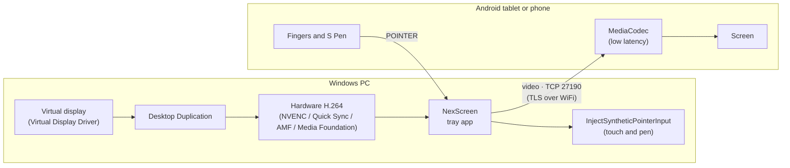

<div align="center">


# NexScreen

**Turn your Android tablet or phone into an extended monitor for Windows, over USB or WiFi, with touch and stylus support.**

[](https://github.com/AlexPerez7/NexScreen/releases/latest)
[](https://github.com/AlexPerez7/NexScreen/actions/workflows/ci.yml)
[](https://github.com/AlexPerez7/NexScreen/releases)
[](LICENSE)


[Download](https://github.com/AlexPerez7/NexScreen/releases/latest) ·
[Changelog](CHANGELOG.md) ·
[Protocol](docs/protocol.md) ·
[Roadmap](PLAN.md) ·
[Español](README.es.md)

</div>

---

NexScreen makes Windows see your tablet (or phone) as **just another display**: drag windows onto
it, use it with your fingers or a stylus, and unplug it without leaving lost windows behind. No
account, no server, no setup: plug in the tablet and it works.

## Features

| | |
|---|---|
| 🖥️ **A real monitor** | A virtual display with the device's native resolution and refresh rate (60, 90 or 120 Hz), without the camera cutout area on phones, and a Windows scale chosen to fit its screen. Place it left, right, above or below, like any display. It can also mirror an existing monitor. |
| ✍️ **Touch and stylus** | Tap to click, two fingers to scroll and zoom. The S Pen reaches Windows as a real pen: pressure, tilt, side button and palm rejection. |
| 🔌 **Zero-config USB** | Plug in the tablet and NexScreen installs the app, opens it and connects. It also updates the app when there is a new version. |
| 📶 **Secure WiFi** | The tablet finds the PC on the network. All traffic is encrypted (TLS) and each device is paired once with a 6-digit code. |
| ⚡ **Low latency** | Own capture pipeline, no ffmpeg: Desktop Duplication, GPU color conversion and hardware H.264 (NVIDIA NVENC directly; Intel Quick Sync and AMD through Media Foundation), with hardware decoding on the device. Sustains the 90 fps of the development tablet and up to 120 fps if the screen supports it. ffmpeg remains as a fallback. |
| 📉 **Adapts to the network** | If the WiFi gets congested it lowers the quality instead of building up lag, and recovers on its own. If the picture gets corrupted, the tablet asks for a full frame and recovers in under a second. |
| 🔄 **Looks after itself** | Tray icon, start with Windows and automatic updates from GitHub (can be turned off). |

## Requirements

| | Minimum | Tested with |
|---|---|---|
| **PC** | 64-bit Windows 10 or 11 | Laptops with an Intel Core i7-13620H (Intel UHD graphics) and an i5-13420H (+ NVIDIA RTX 4060) |
| **Tablet or phone** | Android 8.0 or later | Samsung Galaxy Tab S9 FE (2304×1440, 90 Hz, Android 16) |
| **Video** | Any PC: uses the encoder of the GPU that drives the screen (Intel, NVIDIA or AMD) and, if there is none, Media Foundation on the CPU (up to 60 fps) | |
| **WiFi** (optional) | PC and tablet on the same network, set as **Private** in Windows | |

## Installation

1. Download **`NexScreen-Setup-<version>.exe`** from
   [Releases](https://github.com/AlexPerez7/NexScreen/releases/latest) and run it. It asks for
   administrator rights to install the virtual display and open the firewall.
2. On the tablet, enable **Developer options → USB debugging** (once) and accept the debugging
   prompt when you plug it in.
3. Plug in the tablet. NexScreen installs the app, opens it, and the tablet becomes your second
   screen.

> [!NOTE]
> The installer is not code-signed yet (see [Code signing policy](#code-signing-policy)), so
> Windows SmartScreen may show a warning. Choose **More info → Run anyway**.

The installer shows what it changes on your system before installing, and the only internet
connection NexScreen makes is the optional update check (see the [privacy policy](PRIVACY.md)).

### Connecting over WiFi

Open NexScreen on the tablet and tap your PC in the **PCs on the network** list (or type its IP).
The first time, the PC shows a 6-digit code that you enter on the tablet; after that it connects
by itself.

## Usage

NexScreen lives in an icon next to the clock. Right-click it to choose:

- **Mode:** extend the desktop or mirror a monitor.
- **Position** of the tablet relative to the PC (you can also move it in *Settings → Display*;
  NexScreen remembers where you left it).
- **Quality:** High (20 Mbps), Normal (12 Mbps) or Saver (6 Mbps). This is the maximum: if the
  network can't keep up, it lowers itself and the tray shows it.
- Windows **scale** for the tablet, start with Windows, automatic update checks and the devices
  paired over WiFi.

## Troubleshooting

<details>
<summary><b>The tablet doesn't appear in "PCs on the network"</b></summary>

The WiFi network must be set as **Private** in Windows (*Settings → Network & internet → network
properties*). The installer creates the firewall rules for TCP 27190 and UDP 27191; if you deleted
them, run `scripts\allow-firewall.ps1` as administrator. Meanwhile you can type the PC's IP by hand.
</details>

<details>
<summary><b>Nothing happens when I plug in the tablet</b></summary>

Check that USB debugging is on and that you accepted the prompt on the tablet ("Allow USB
debugging?"). Some cables only charge: try another one.
</details>

<details>
<summary><b>The picture freezes while the Windows session is locked</b></summary>

This is expected: Windows doesn't allow capturing the lock screen. The stream resumes by itself
when you unlock.
</details>

<details>
<summary><b>Text looks too small on the tablet</b></summary>

The scale is **Automatic** by default: it is chosen from the screen density (150% on an 11" tablet,
250-300% on a phone). If you prefer another size, change it from **Scale** in the tray menu.
</details>

## How it works



- When the tablet connects, a virtual monitor with its native resolution is added (Windows CCD API)
  and removed when it disconnects.
- If Windows interrupts the capture (reordering displays, UAC) it restarts without dropping the
  connection. With the native pipeline, keyframe requests and bitrate changes are applied directly
  to the encoder; with the ffmpeg fallback they start a new capture in parallel, without freezing
  the picture.
- Over USB the PC sets up an `adb reverse` tunnel; over WiFi the tablet finds the PC with a UDP
  broadcast.
- The protocol is documented in [docs/protocol.md](docs/protocol.md).

## Development

<details>
<summary><b>Build and test</b></summary>

Requirements: [.NET 8 SDK](https://dotnet.microsoft.com/download), Android Studio (or the Android
SDK + a JDK) and [Inno Setup 6](https://jrsoftware.org/isinfo.php) for the installer. For the
ffmpeg fallback, ffmpeg with `ddagrab` and `h264_qsv` on the PATH (`winget install Gyan.FFmpeg`).

```powershell
# Host (Windows)
dotnet build host
dotnet test host
host\src\NexScreen.Tray\bin\Debug\net8.0-windows\NexScreen.exe            # tray app
host\src\NexScreen.Host\bin\Debug\net8.0-windows\nexscreen-host.exe --help # diagnostics console

# Android app
android\gradlew.bat -p android assembleDebug
adb install -r android\app\build\outputs\apk\debug\app-debug.apk

# Virtual display (once, as administrator) and firewall for WiFi
scripts\install-virtual-display.ps1
scripts\allow-firewall.ps1

# Installer -> dist\NexScreen-Setup-<version>.exe
installer\build.ps1
```

Without a tablet, `python host\tools\fake_client.py` simulates one: it saves the video it
receives and can simulate slow WiFi (`--limit-mbps`) or request keyframes (`--request-keyframe`).
`nexscreen-host --list-displays` shows the displays, the virtual monitor and the scale.
</details>

<details>
<summary><b>Repository layout</b></summary>

```
host/                       Windows (C# / .NET 8)
  src/NexScreen.Core/       protocol, video, virtual display, input, USB, security, updates
  src/NexScreen.Tray/       tray app (NexScreen.exe)
  src/NexScreen.Host/       development and diagnostics console (nexscreen-host.exe)
  tests/                    tests (xUnit)
  tools/                    test client and utilities
android/                    tablet app (Kotlin)
installer/                  installer (Inno Setup) and build script
scripts/                    virtual display, firewall, manual USB, release notes
docs/                       network protocol
```
</details>

<details>
<summary><b>Publishing a release</b></summary>

1. Add the `## [X.Y.Z] - date` section to [CHANGELOG.md](CHANGELOG.md).
2. `git tag vX.Y.Z` and `git push origin vX.Y.Z`.

GitHub Actions runs the tests, signs the APK, builds the installer and publishes the release with
`NexScreen-Setup-X.Y.Z.exe` and `NexScreen-X.Y.Z.apk`. PCs running NexScreen update from the tray,
and tablets update when plugged in.
</details>

> The project's internal documentation (`CHANGELOG.md`, `PLAN.md`, `docs/`, `CLAUDE.md`) and the
> installer and app texts are written in Spanish. A Spanish version of this page is in
> [README.es.md](README.es.md).

## Roadmap

Next up, in priority order (technical detail in [PLAN.md](PLAN.md)):

- [x] Extended monitor, touch and S Pen, USB and WiFi
- [x] Installer, automatic updates, encrypted WiFi with pairing
- [x] Network-adaptive quality and video error recovery
- [x] MIT license
- [ ] Installer code signing
- [x] 90 Hz and beyond
- [ ] PC audio on the tablet
- [x] Native capture and encoding (lower latency)
- [ ] Multiple tablets at once

## Credits

- [farmerbb/SecondScreen](https://github.com/farmerbb/SecondScreen) (Apache 2.0): ideas for
  resolution profiles, always-on screen and immersive mode.
- [OnCloud125252/Spacedesk-Viewer](https://github.com/OnCloud125252/Spacedesk-Viewer): the concept
  of a lightweight viewer that connects by itself. No code is reused.
- Components included in the installer (FFmpeg LGPL, adb, Virtual Display Driver, nefcon): see
  [installer/THIRD-PARTY-NOTICES.md](installer/THIRD-PARTY-NOTICES.md).

## License

NexScreen is released under the [MIT license](LICENSE). Third-party components keep their own
licenses (see [installer/THIRD-PARTY-NOTICES.md](installer/THIRD-PARTY-NOTICES.md)).

## Code signing policy

Free code signing provided by [SignPath.io](https://signpath.io), certificate by
[SignPath Foundation](https://signpath.org).

*(Pending: the Windows installer will be signed once SignPath Foundation approves the project;
earlier releases are unsigned.)*

- **What is signed:** the installer `NexScreen-Setup-X.Y.Z.exe` and the NexScreen executables it
  contains, built by GitHub Actions from this repository's source code
  ([`release.yml`](.github/workflows/release.yml)). Third-party programs (ffmpeg, adb, the virtual
  display driver) are included as published by their authors.
- **Roles:** author, reviewer and approver: [Alex Pérez Argomedo](https://github.com/AlexPerez7)
  (sole maintainer). Every release signing request is approved manually.
- **Privacy:** NexScreen does not transfer any information to other networked systems, except the
  update check against GitHub, which you can turn off. See the [privacy policy](PRIVACY.md).
