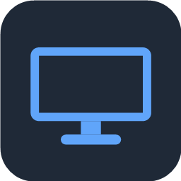
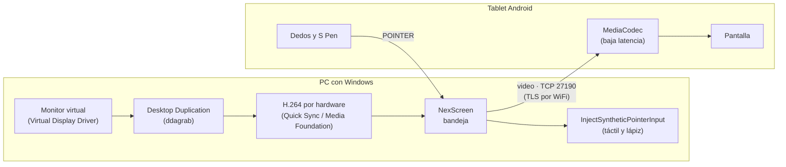

<div align="center">



# NexScreen

**Convierte tu tablet Android en un monitor extendido de Windows, por USB o WiFi, con táctil y lápiz.**

[](https://github.com/AlexPerez7/NexScreen/releases/latest)
[](https://github.com/AlexPerez7/NexScreen/actions/workflows/ci.yml)
[](https://github.com/AlexPerez7/NexScreen/releases)


[Descargar](https://github.com/AlexPerez7/NexScreen/releases/latest) ·
[Novedades](CHANGELOG.md) ·
[Protocolo](docs/protocol.md) ·
[Hoja de ruta](PLAN.md)

</div>

---

NexScreen hace que Windows vea tu tablet como **una pantalla más**: puedes arrastrar ventanas hacia
ella, usarla con los dedos o con el lápiz, y desconectarla sin que queden ventanas perdidas. No
hace falta cuenta, servidor ni configuración: enchufas la tablet y funciona.

## Características

| | |
|---|---|
| 🖥️ **Monitor real** | Un monitor virtual con la resolución nativa de la tablet. Lo ubicas a la izquierda, derecha, arriba o abajo, como cualquier pantalla. También puede espejar un monitor existente. |
| ✍️ **Táctil y lápiz** | Tocar es clic, dos dedos desplazan y hacen zoom. El S Pen llega a Windows como un lápiz de verdad: presión, inclinación, botón lateral y rechazo de palma. |
| 🔌 **USB sin configurar** | Al enchufar la tablet, NexScreen instala la app, la abre y se conecta. También la actualiza cuando hay una versión nueva. |
| 📶 **WiFi seguro** | La tablet encuentra el PC en la red. Todo el tráfico va cifrado (TLS) y cada tablet se empareja una vez con un código de 6 dígitos. |
| ⚡ **Baja latencia** | Captura con Desktop Duplication y H.264 por hardware (Intel Quick Sync), decodificación por hardware en la tablet. ~60 fps a 2304×1440. |
| 📉 **Se adapta a la red** | Si el WiFi se congestiona, baja la calidad en vez de acumular atraso y la recupera sola. Si la imagen se daña, la tablet pide una completa y se recupera en menos de un segundo. |
| 🔄 **Se mantiene solo** | Ícono en la bandeja, inicio con Windows y actualizaciones automáticas desde GitHub. |

## Requisitos

| | Mínimo | Probado con |
|---|---|---|
| **PC** | Windows 10 u 11 de 64 bits | Notebook con Intel Core i7-13620H (gráficos Intel UHD) |
| **Tablet** | Android 8.0 o superior | Samsung Galaxy Tab S9 FE (2304×1440, Android 16) |
| **Video** | Cualquier PC: Intel Quick Sync si está disponible, si no Media Foundation | |
| **WiFi** (opcional) | PC y tablet en la misma red, marcada como **Privada** en Windows | |

## Instalación

1. Descarga **`NexScreen-Setup-<versión>.exe`** desde
   [Releases](https://github.com/AlexPerez7/NexScreen/releases/latest) y ejecútalo. Pide permisos de
   administrador para instalar el monitor virtual y abrir el firewall.
2. En la tablet, activa **Opciones de desarrollador → Depuración USB** (una sola vez) y acepta el
   aviso de depuración cuando la enchufes.
3. Enchufa la tablet. NexScreen instala la app, la abre y la tablet pasa a ser tu segunda pantalla.

> [!NOTE]
> El instalador todavía no está firmado, así que Windows SmartScreen puede mostrar una advertencia.
> Elige **Más información → Ejecutar de todas formas**.

### Conectar por WiFi

Abre NexScreen en la tablet y toca tu PC en la lista **PCs en la red** (o escribe su IP). La primera
vez el PC muestra un código de 6 dígitos que tienes que ingresar en la tablet; después se conecta
sola.

## Uso

NexScreen vive en un ícono junto al reloj. Con clic derecho eliges:

- **Modo:** extender el escritorio o espejar un monitor.
- **Posición** de la tablet respecto del PC (también puedes moverla en *Configuración → Pantalla*;
  NexScreen recuerda dónde la dejaste).
- **Calidad:** Alta (20 Mbps), Normal (12 Mbps) o Ahorro (6 Mbps). Es el máximo: si la red no da
  abasto, baja sola y la bandeja lo indica.
- **Escala** de Windows para la tablet, iniciar con Windows y las tablets emparejadas por WiFi.

## Solución de problemas

<details>
<summary><b>La tablet no aparece en "PCs en la red"</b></summary>

La red WiFi tiene que estar marcada como **Privada** en Windows (*Configuración → Red e Internet →
propiedades de la red*). El instalador crea las reglas de firewall para TCP 27190 y UDP 27191; si
las borraste, ejecuta `scripts\allow-firewall.ps1` como administrador. Mientras tanto puedes
escribir la IP del PC a mano.
</details>

<details>
<summary><b>Al enchufar la tablet no pasa nada</b></summary>

Revisa que la depuración USB esté activa y que hayas aceptado el aviso en la tablet ("¿Permitir
depuración USB?"). Algunos cables solo cargan: prueba con otro.
</details>

<details>
<summary><b>La imagen se congela con la sesión de Windows bloqueada</b></summary>

Es esperado: Windows no permite capturar la pantalla de bloqueo. La transmisión sigue sola al
desbloquear.
</details>

<details>
<summary><b>El texto se ve muy chico en la tablet</b></summary>

Sube la **Escala** desde el menú de la bandeja (por ejemplo, 150 %).
</details>

## Cómo funciona



- Al conectarse la tablet se agrega un monitor virtual con su resolución nativa (API CCD de
  Windows) y se quita al desconectarla.
- Si Windows interrumpe la captura (reordenar pantallas, UAC) se reinicia sin cortar la conexión.
  Los cambios de calidad y los pedidos de imagen completa se hacen arrancando una captura nueva en
  paralelo, sin congelar la imagen.
- Por USB el PC arma un túnel `adb reverse`; por WiFi la tablet busca el PC con un broadcast UDP.
- El protocolo está documentado en [docs/protocol.md](docs/protocol.md).

## Desarrollo

<details>
<summary><b>Compilar y probar</b></summary>

Requisitos: [.NET 8 SDK](https://dotnet.microsoft.com/download), ffmpeg con `ddagrab` y
`h264_qsv` en el PATH (`winget install Gyan.FFmpeg`), Android Studio (o Android SDK + JDK) e
[Inno Setup 6](https://jrsoftware.org/isinfo.php) para el instalador.

```powershell
# Host (Windows)
dotnet build host
dotnet test host
host\src\NexScreen.Tray\bin\Debug\net8.0-windows\NexScreen.exe            # app de bandeja
host\src\NexScreen.Host\bin\Debug\net8.0-windows\nexscreen-host.exe --help # consola de diagnóstico

# App Android
android\gradlew.bat -p android assembleDebug
adb install -r android\app\build\outputs\apk\debug\app-debug.apk

# Monitor virtual (una vez, como administrador) y firewall para WiFi
scripts\install-virtual-display.ps1
scripts\allow-firewall.ps1

# Instalador -> dist\NexScreen-Setup-<versión>.exe
installer\build.ps1
```

Sin tablet, `python host\tools\fake_client.py` simula una: guarda el video recibido y puede
simular un WiFi lento (`--limit-mbps`) o pedir keyframes (`--request-keyframe`).
`nexscreen-host --list-displays` muestra las pantallas, el monitor virtual y la escala.
</details>

<details>
<summary><b>Estructura del repositorio</b></summary>

```
host/                       Windows (C# / .NET 8)
  src/NexScreen.Core/       protocolo, video, monitor virtual, input, USB, seguridad, actualizaciones
  src/NexScreen.Tray/       app de bandeja (NexScreen.exe)
  src/NexScreen.Host/       consola de desarrollo y diagnóstico (nexscreen-host.exe)
  tests/                    tests (xUnit)
  tools/                    cliente de prueba y utilidades
android/                    app de la tablet (Kotlin)
installer/                  instalador (Inno Setup) y script de build
scripts/                    monitor virtual, firewall, USB manual, notas de release
docs/                       protocolo de red
```
</details>

<details>
<summary><b>Publicar una versión</b></summary>

1. Agrega la sección `## [X.Y.Z] - fecha` en [CHANGELOG.md](CHANGELOG.md).
2. `git tag vX.Y.Z` y `git push origin vX.Y.Z`.

GitHub Actions corre los tests, firma el APK, arma el instalador y publica el release con
`NexScreen-Setup-X.Y.Z.exe` y `NexScreen-X.Y.Z.apk`. Los PCs con NexScreen se actualizan desde la
bandeja, y las tablets al enchufarlas.
</details>

## Hoja de ruta

Lo próximo, en orden de prioridad (detalle técnico en [PLAN.md](PLAN.md)):

- [x] Monitor extendido, táctil y S Pen, USB y WiFi
- [x] Instalador, actualizaciones automáticas, WiFi cifrado con emparejamiento
- [x] Calidad adaptativa a la red y recuperación de errores de video
- [ ] Licencia y firma del instalador
- [ ] 90 Hz
- [ ] Audio del PC en la tablet
- [ ] Captura y codificación nativas (menos latencia, instalador más chico)
- [ ] Varias tablets a la vez

## Créditos

- [farmerbb/SecondScreen](https://github.com/farmerbb/SecondScreen) (Apache 2.0): ideas de
  perfiles de resolución, pantalla siempre encendida y modo inmersivo.
- [OnCloud125252/Spacedesk-Viewer](https://github.com/OnCloud125252/Spacedesk-Viewer): concepto de
  visor liviano que se conecta solo. No se reutiliza código.
- Componentes incluidos en el instalador (FFmpeg LGPL, adb, Virtual Display Driver, nefcon): ver
  [installer/THIRD-PARTY-NOTICES.md](installer/THIRD-PARTY-NOTICES.md).

## Licencia

Este proyecto todavía no tiene licencia: el código es visible, pero no se otorga permiso para
reutilizarlo. Los componentes de terceros mantienen sus propias licencias.
